<!-- AWAKEN:START -->
<!-- Generated by git-profile-awaken. Edit awaken.json instead of this block. -->






<a href="https://github.com/HaVuHongPhuc/BloodLink_Project"></a>
<a href="https://github.com/HaVuHongPhuc/Crypto_AI_Project"></a>

<a href="https://github.com/HaVuHongPhuc/Vietnamese_Extractive_Question_Answering_on_UIT_ViQuAD_2.0_Project"></a>




<!-- AWAKEN:END -->
